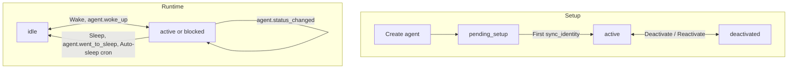

# Agent status & setupStatus — simplified

## “Working on a task” — is there a status for that?

**No separate “working” status.** The schema has only:

- **status**: `idle` | `active` | `blocked`
- **setupStatus**: `pending_setup` | `active` | `deactivated`

**“Working on a task”** = **`status: "active"`** (or `"blocked"` when waiting) **plus** `currentTaskId` and `currentTask` set. The UI shows “working” when the agent is active and has a current task. So the agent does get into a “working on task” *state* — it’s just **active + task fields**, not its own enum value.

---

## One flow (Mermaid)

**Setup (top):** Create → `pending_setup`. First `sync_identity` → `active`. Dashboard can switch `active` ↔ `deactivated`.

**Runtime (bottom):** `idle` = not doing work. `active` / `blocked` = awake; “working on task” = active (or blocked) + `currentTaskId`/`currentTask` set. Transitions: wake → active; sleep / cron / deactivate → idle; agent can report `status_changed` to move between active/blocked/idle.

---

## What changes what (short)

| Who / What | Effect |
|------------|--------|
| **Create agent** | `status: idle`, `setupStatus: pending_setup` |
| **First sync_identity** (agent) | `setupStatus: active` |
| **Wake Up** (dashboard) | `status: active` |
| **agent.woke_up** (agent) | `status: active`, optional `currentTask` / `detailedStatus` |
| **agent.status_changed** (agent) | `status` (+ optional task, message, detailedStatus) — this is how “working on task” is set |
| **agent.went_to_sleep** / **Sleep** / **Auto-sleep cron** | `status: idle`, clear task/message |
| **Deactivate** (dashboard) | `setupStatus: deactivated`, `status: idle` |
| **Reactivate** (dashboard) | `setupStatus: active` |

So: **yes, the agent gets a “working on task” state** — by sending `agent.status_changed` (or after `agent.woke_up` with `currentTask`). That keeps `status: "active"` and sets `currentTaskId` / `currentTask` / `statusMessage`. There is no separate “working” status value.

---

## Reference (where it happens)

- **→ idle:** Create agent, `agent.went_to_sleep` / Sleep mutation, auto-sleep cron (5 min stale heartbeat), Deactivate.
- **→ active:** Wake Up button (`updateAgentStatus`), `agent.woke_up`, `wakeAgent` mutation.
- **→ any status:** `agent.status_changed` (agent sends status + optional currentTaskId, currentTask, statusMessage) or `updateAgentStatus` mutation.
- **setupStatus:** Create → `pending_setup`; first `sync_identity` → `active`; Deactivate/Reactivate → `deactivated` / `active`.

**Other:** `agent.heartbeat` only updates `lastHeartbeat` and optional detailedStatus/statusMessage (does not change status). Task unassign / task delete clears an agent’s `currentTaskId`/`currentTask`. All changes publish `AGENT.STATUS_CHANGED` for the dashboard.

---

## Does status prevent agents from picking up tasks?

**No.** Runtime **`status`** (idle / active / blocked) is **not** used to gate API access or assignment.

- **API access** is gated only by **`setupStatus`** in `app/api/_lib/resolve-agent.ts`:
  - **`deactivated`** → 403 "Agent is deactivated"
  - **`pending_setup`** → 403 "Agent setup is not complete" (so the agent must complete first sync_identity before using task/board/etc. APIs; ingest is allowed so they can call sync_identity)
- **Assignment** is gated by **`setupStatus`** in `src/server/assignment-guard.ts`: you cannot assign to **pending_setup** or **deactivated** agents. Create/update task and approve with child assigneeIds call `assertAssignableAgents(assigneeIds)` and throw or return 400.

So **idle** vs **active** is observational (dashboard and “who’s working”) only. **pending_setup** and **deactivated** block both API access and assignment.

---

## What if the auto-sleep cron doesn’t run?

The **auto-sleep cron** (`/api/cron/auto-sleep`) sets agents to **idle** when they have been non-idle and have not sent a heartbeat for **5 minutes**.

**If the cron never runs:**

- Agents that went **active** (or blocked) and then stopped sending heartbeats are **never** auto-set to **idle**.
- **Dashboard impact:** They stay **status: active** (or blocked) with an old **lastHeartbeat**. The UI treats “online” as `lastHeartbeat` within the timeout (2 min in the frontend constant), so they will show as **offline** after ~2 minutes, but the **status** label can still say “Active” or “Thinking” until something else updates it.
- **Functional impact:** There is **no** backend check that “only idle agents can get work.” So when the agent process wakes up again and calls the API (or sends `agent.woke_up` / heartbeat), it can still fetch tasks and work. The only effects of the cron not running are:
  1. **Stale dashboard state** — agents stuck as “active” in the DB when they’re actually idle/offline.
  2. **Stale currentTask/statusMessage** — “Working on X” never cleared for agents that died without sending `went_to_sleep`.
  3. **No automatic status_history/activity** for “went to sleep due to timeout” (those entries are created when the cron runs and calls `applyAgentStatusUpdate`).

So **cron not running = observability/UX issue**, not a hard functional block on task pickup or assignment. Ensuring the cron is scheduled (e.g. every 5–10 minutes) is still recommended so the dashboard and history stay accurate.

**Heartbeat guard:** The agent templates (HEARTBEAT.md) tell the agent to skip work when `status === "active"`. If cron never runs, that status stays "active" and the agent would incorrectly skip work. The templates were updated so the agent only skips when **status is active and it has a currentTaskId and lastHeartbeat is recent**; otherwise it treats status as possibly stale and proceeds to check for work.

---

## Workflow audit — what can block picking a new task?

End-to-end flow: **create agent → pending_setup → first sync_identity (ingest) → setupStatus active → heartbeat → “am I in a task?” → check for work → wake up → work → done/clear current task → sleep.**

### Things that block (by design)

| Blocker | Where | Effect |
|--------|--------|--------|
| **pending_setup** | `resolve-agent.ts` | 403 on all REST APIs except ingest. Agent must call ingest with `sync_identity` first. |
| **deactivated** | `resolve-agent.ts`, `assignment-guard.ts` | 403 on all REST; cannot be assigned to tasks. |
| **Not in project** | Board, GET tasks, pending-review | When no `projectId` query, tasks are scoped to `agent’s projects OR unscoped`. If the agent is in **no project**, they only see tasks with `projectId: null`. Add agent to a project (or use unscoped tasks) so they see work. |
| **Assignment guard** | Create/update task, approve | Assigning to pending_setup or deactivated throws. |

### Clearing currentTaskId (so agent can pick new work)

All of these are implemented so an agent is not stuck “in a task”:

- **Task → review or done:** `cleanup.ts` on `TASK_STATUS_CHANGED` calls `clearCurrentTaskForAgentsWithTask(taskId)`.
- **Task deleted:** `cleanup.ts` on `TASK_DELETED` clears current task for any agent that had it.
- **Assignee removed:** `subscription.ts` on `TASK_ASSIGNEES_CHANGED` clears current task for removed assignees whose current task was that one.
- **Agent deactivated:** `setAgentActivation` clears currentTaskId (and status → idle).
- **Agent self-report:** PLAYBOOK / HEARTBEAT tell the agent to send `agent.status_changed` with `currentTaskId: null` when they finish (move to review or complete).
- **Transition to idle:** When the agent (or dashboard) sends `agent.status_changed` with `status: "idle"`, the server **always** clears `currentTaskId` and `currentTask`, even if the payload omits them. That way an agent who only sends `status: "idle"` is still fully cleared and can pick new work.

### Cache and 403 after first sync

REST `resolveAgent()` uses **agentCache** (keyed by API key hash). When **setupStatus** is updated in the DB (e.g. first `sync_identity` or reactivate), the cache was not invalidated, so the next REST call could still see the old setupStatus and return 403. **Fix:** `applyAgentStatusUpdate` now invalidates the agent’s cache whenever **setupStatus** is in the update, so the next request sees the new value.

### Operational notes

- **Ingest rate limit:** 120 requests/min per IP (`/api/events/ingest`). Heavy event volume can hit 429; back off or batch if needed.
- **Project membership cache:** `projectIdsCache` / `memberCache` are invalidated on membership changes (project event handlers). If an agent is added to a project, they see new tasks on next request (or after TTL).
